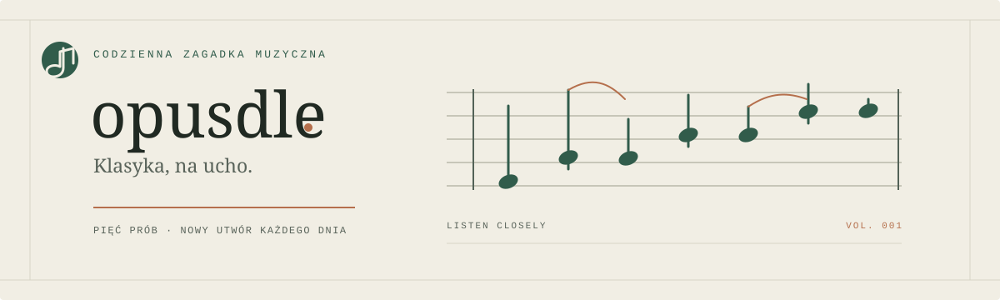

<div align="center">



<br />

**Codzienna zagadka muzyczna. Pięć prób. Klasyka na ucho.**

<br />

[**ZAGRAJ W OPUSDLE →**](https://kajton.github.io/Opusdle/)

<br /><br />

[](https://github.com/kajton/Opusdle/actions/workflows/deploy.yml)


</div>

## Jak grać

Odgadnij ukryty utwór, zanim skończą się próby. Każda błędna odpowiedź odsłania kolejny takt, a podpowiedzi porównują kompozytora, epokę, gatunek, tonację i rok.

- **Zagadka dnia** — ta sama kompozycja dla wszystkich, nowa każdego dnia.
- **Tryb treningowy** — ćwicz bez limitu na losowych utworach.
- **Nuty i dźwięk** — zapis oraz odtwarzanie powstają w przeglądarce, bez plików audio.
- **Wyniki** — zachowaj serię i udostępnij rezultat.

## Uruchomienie lokalne

Wymagany Node.js 20.19+ lub 22.12+.

```bash
npm install
npm run dev
```

Build produkcyjny: `npm run build`.

## Publikacja

GitHub Actions buduje aplikację po każdym pushu do gałęzi `main` i publikuje katalog `dist` w GitHub Pages.

Przy pierwszej publikacji ustaw w repozytorium **Settings → Pages → Build and deployment → Source → GitHub Actions**. Po zakończeniu workflow gra będzie dostępna pod adresem [kajton.github.io/Opusdle](https://kajton.github.io/Opusdle/).

## Technologie

React · TypeScript · Vite · abcjs · Web Audio API